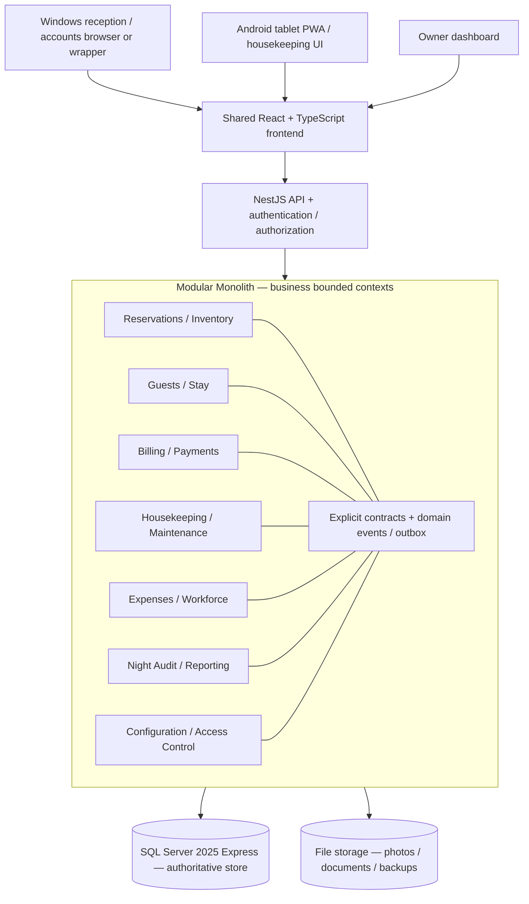

# Hotel Control Centre — Conversation Export and Master Planning Handoff

**Prepared:** 24 October 2026  
**For:** Continuing the Hotel Control Centre planning project in ChatGPT Work  
**Scope:** This conversation, beginning with the request to find reusable open-source hotel PMS repositories and ending with the decision to create an interactive prototype before production development.

> **Transcript integrity note:** This document is a **comprehensive, manually reconstructed Markdown record**, not an automated byte-for-byte platform chat export. It preserves the substance, sequence, important original user wording, feature specifications, decisions, caveats, sources and deliverables from the conversation available here. Some assistant messages are consolidated or paraphrased rather than copied verbatim; small voice acknowledgments and transient progress updates are not all reproduced. If exact wording of every utterance is required for legal or archival use, obtain an official ChatGPT data export separately. **Do not present this file as a verbatim transcript.**

---

# PART I — MASTER HANDOFF FOR CHATGPT WORK

## 1. Project identity and objective

**Working project name:** Hotel Control Centre (HCC).  
**Owner/use case:** An internally deployed property management and hotel operations application for the user's own lodging business in India; **not planned for commercial distribution**.  
**Product goal:** Bring all day-to-day hotel operations into one reliable, owner-controlled system: room availability, reservations, guest registration and stays, billing and GST, payments, housekeeping, expenses, employees, maintenance, daily closing, financial reporting and—later—automated accounting and other advanced features.

**Guiding strategy:** Learn from six existing GitHub hotel-PMS codebases, legally reuse suitable permissively licensed code, independently reimplement ideas/functions from more restrictive projects where necessary, and reuse the user's own Saagar Control Centre (SCC) and eventually ETP Report Engine components. Avoid building every feature from zero, but equally avoid pasting together incompatible monoliths.

**User's metaphor:** The six repositories are like *already chopped vegetables in a kitchen*, from which a chef prepares a salad. Interpretation: reuse completed building blocks as much as practical, while recognising that data-model integration, transaction consistency, adapters and quality assurance still require engineering effort.

**Principle:** Design and agree on the architecture, access control, workflows, financial rules, data ownership, master configuration and prototypes **before committing to the main implementation**, to minimise later rework.

## 2. Decision register: agreed versus not yet specified

The user has positively agreed to the *direction* of the following decisions. “Agreed” does **not** mean a detailed implementation specification or tested source integration has already been completed.

| ID | Topic | Agreed direction | Status / follow-up |
|---|---|---|---|
| DEC-01 | Intended audience | Internal hotel/lodging use, not a public commercial PMS offering | Agreed |
| DEC-02 | Feature scope | 26 proposed modules in three phases; first 12 comprise hotel-operations MVP | Broad list agreed; fine-grained functional acceptance criteria still needed |
| DEC-03 | Main database | **Microsoft SQL Server 2025 Express** as central, authoritative store | Agreed; actual schema and performance testing pending |
| DEC-04 | Architecture | **Modular Monolith + Hexagonal (Ports & Adapters) + DDD/bounded contexts + internal events** | Agreed; module boundaries/contracts/ADR documents pending |
| DEC-05 | Backend | **NestJS + TypeScript** proposed for maximum compatibility with HAIP | Agreed as preferred direction, verify driver/ORM choice |
| DEC-06 | Frontend | **React + TypeScript**, responsive desktop/tablet/phone UI | Agreed; actual design system pending |
| DEC-07 | Desktop delivery | Windows-hosted server; browser frontend; optional EXE/desktop wrapper | Agreed; packaging/service setup pending |
| DEC-08 | Android delivery | Same application via responsive browser/PWA over hotel LAN/Wi-Fi | Agreed; device requirements and PWA behaviours pending |
| DEC-09 | SQLite | Not the master database; optionally use for restricted offline tablet cache in a later phase | Agreed conceptually; offline conflict/sync policy not specified |
| DEC-10 | User access | Central **Master Access Control Panel** with roles, user enable/disable, granular actions, approvals and scopes | Explicit user priority; full permission matrix pending |
| DEC-11 | UI reference | Kamra for hotel workflow usability; Open Hotel PMS for compatible UI code and housekeeping; QloApps for mature conventional admin patterns | Direction agreed; UX audit/device testing pending |
| DEC-12 | Repository composition | HAIP for selected backend logic; Open Hotel PMS for selected UI; others for business-rule references and licence-checked reuse | Source selection conceptual; technical/security/licence audit not complete |
| DEC-13 | Business workflows | Specify happy paths, alternative paths, exception rules and state machines before tables/code | Agreed; actual decisions pending |
| DEC-14 | Financial architecture | Distinguish charges/revenue, receipts/advances, refundable deposits, settlements, taxes, refunds and proper journal posting | Agreed in principle; accounting rulebook pending |
| DEC-15 | Owner configuration | Hotel policy, tariffs, tax rules, discount limits, operational timings and other configurable values under a master settings panel | Agreed; inventory of configurable keys pending |
| DEC-16 | Database boundaries | Module-owned tables/schemas, explicit interfaces; no cross-module direct writes | Agreed architectural policy |
| DEC-17 | Early validation | **Build a clickable end-to-end UI mockup before full software building** | Agreed and **next major deliverable** |
| DEC-18 | Prototype technology | Prefer React + dummy in-memory/API services, so some frontend code can survive into production; HTML deliverable browsable on Windows and Android | Recommended/accepted concept; exact prototype packaging TBD |
| DEC-19 | Deployment | Local-network-first hotel operation, without dependence on third-party SaaS for core hotel functions | Agreed; security, remote access and backup design TBD |
| DEC-20 | Project schedule | Approx. 8–12 weeks for internal MVP and 14–20 weeks for stable initial production **assuming one experienced full-time developer** | **Planning estimate, not commitment**, subject to scope/code audit |

### Clarification of “decided” versus “not yet locked”

- SQL Server edition is chosen, but **the schema, migration standards, read model, concurrency strategy, indexes and backup/restore plan are not finalised**.
- Hexagonal modular monolith is chosen, but **the bounded contexts, public module contracts and event payloads are not specified**.
- Roles/permissions are chosen, but **the exact action- and field-level permission matrix must be approved**.
- React is chosen, but **no final UI screens/design system have yet been approved**.
- Repositories have been shortlisted and selectively inspected, but **no six-way compilation, deployment, penetration test, licence compatibility opinion or SQL Server migration has been completed**.
- ETP Report Engine GitHub repository was made **private**. It has **not** been thoroughly source-audited for this hotel project; the owner may provide a sanitized ZIP later. **Do not assume its internals beyond what the user states.**

---

## 3. Six third-party repositories researched

All links here originate from the conversation. Refer to the published licences and exact file-level notices before copying any code. Repository feature descriptions below are **published/documented or selectively source-inspected**, not the outcome of an independent complete end-to-end functional test.

| Repository | Link | Tech / licence discussed | Strongest candidate functionality | Caution |
|---|---|---|---|---|
| **HAIP — Hotel AI Platform** | https://github.com/TelivityAI/haip | TypeScript / NestJS / Apache-2.0 | Backend reservation states, folios, charges, payments, nightly accounting, housekeeping, domain models and contracts | Some functionality is unfinished; PostgreSQL-specific persistence must be adapted to SQL Server; tests need independent execution |
| **Open Hotel PMS** | https://github.com/peeraseepat-cell/open-hotel-pms | Next.js / TypeScript / Supabase/PostgreSQL / MIT reported | Front desk UI, room planning, housekeeping, night-audit UI, maintenance and accounting screens | Public repository reportedly older than private production version; verify which endpoints are truly complete |
| **Kamra PMS** | https://github.com/Kamra-PMS/kamra-pms | Python/Frappe, React, MariaDB / AGPL-3.0 reported | India-oriented GST/folios, reception, check-in, POS, cashier, housekeeping, night audit and workflow ideas | Frappe-dependent; licence obligations matter even for private/internal use; use as requirements/design reference unless legal reuse path approved |
| **QloApps** | https://github.com/Qloapps/QloApps | PHP/MySQL / OSL-3.0 | Mature booking UI, room/tariff master, promotions, rate rules, reservations and guest-registration ideas | Some front-desk/housekeeping functionality sold as add-ons and not necessarily available as free source; core code has OSL file notices |
| **HotelDruid** | https://github.com/digital-druid/hoteldruid | PHP; SQLite/MySQL/PostgreSQL / AGPL-3.0 reported | Room assignment, booking calendars, occupancy/price handling, simpler local PMS design | GitHub source reportedly stale relative to latest official downloads; booking engine/channel manager may be proprietary |
| **miniCal** | https://github.com/pankaj9296/minical | PHP/MySQL / OSL-3.0 reported | Legacy calendar/extension conventions | Original upstream unavailable during investigation; fork lacks clear maintained release; **not a primary foundation** |

Supporting sites mentioned:
- QloApps demo: https://demo.qloapps.com/
- Kamra demo: https://demo.kamrapms.com/
- HotelDruid official download: https://www.hoteldruid.com/en/download.html
- QloApps front desk: https://qloapps.com/qloapps-front-desk-system/

### Functional assessment from earlier discussion

- **Most mature/established operational PMS:** QloApps and HotelDruid.
- **Best India-specific operational match:** Kamra PMS.
- **Most flexible permissive backend candidate:** HAIP (Apache-2.0), after validating module completeness.
- **Best permissively licensed UI/operations candidate:** Open Hotel PMS (MIT), but validate completeness of *public* snapshot.
- **Lowest priority:** miniCal.

### Repository-to-module selection (candidate mapping, not approved copied code)

| Planned functionality | Preferred reference / candidate source | Intended method |
|---|---|---|
| Reservation state machine / guest booking | HAIP, with QloApps as workflow comparison | Adapt licence-compatible core; SQL Server adapter |
| Room occupancy, calendar, availability | Open Hotel PMS + HotelDruid + HAIP | UI reuse where MIT permits; implement robust transactional booking logic |
| Front-office user experience | Kamra + Open Hotel PMS + QloApps | Reference workflows; selectively reuse MIT components |
| GST-aware folio, registration, check-in | Kamra PMS | Study requirements, independent implementation and tax validation |
| Folio, cash desk and settlement | HAIP + Kamra + SCC | Adapt Apache components plus build local accounting logic |
| Housekeeping / inspection | Open Hotel PMS + HAIP | UI and application logic after test/licence audit |
| Night audit / daily closing | HAIP + Kamra + Open Hotel PMS | Implement idempotent posting and transaction/outbox guarantees |
| Expense manager | User's Saagar Control Centre | Adapt own code and map to normalized SQL Server tables |
| Staff, leave, attendance, checklists | User's SCC | Port/adapt own business rules, not SQLite/localStorage persistence layer |
| Tariffs, pricing and offers | QloApps + HAIP | Use functional specifications / permissible source |
| Maintenance and stock | Open Hotel PMS + SCC | Adapt interfaces and business patterns |
| Reports / exports | SCC patterns; ETP in future once owner authorizes code access | Independent report/data adapters |
| Future automated accounting | HCC ledger model + earlier SCC/ETP ideas | New domain design using double-entry accounting rules |

### Licence direction

- Owner **does not plan commercial sale**, but that **does not eliminate** open-source licence obligations.
- Apache-2.0/MIT are typically more convenient for a privately modified internal application, provided notices/licence terms and other requirements are met.
- AGPL-3.0/OSL-3.0 have additional conditions, particularly relevant depending on network use, modifications, access, redistribution or deployment; obtain qualified advice on specific files and planned use if copying code.
- **Learning ideas, workflows and high-level algorithms** is different from **copying source code**. Avoid line-for-line translations or reproducing protected expression to evade licence conditions. Use a written behavioural specification and an independent implementation, or obtain proper permissions.
- Maintain a **third-party source register**: repository, commit hash, file path, exact licence/SPDX, attribution, derivation method, modifications, dependencies and review approval.

---

## 4. Existing first-party assets

### Saagar Control Centre (SCC)

Public source at the time of previous investigation: https://github.com/sagarbora91/saagar-control-centre

The SCC repository was inspected at a high level: an offline HTML/JavaScript + Capacitor Android application with an active SQLite-primary storage layer, modular embedded HTML applications, a cross-module event bus, security and reporting tests, receipt/photo storage and backup/recovery tooling. It is **not** currently a SQL Server-based shared web application.

Previously documented SCC functional modules include Stock Register, Watch Service Centre, Queue Management, Daily Staff Register, Expense Manager, Grooming, CRO Audit, Payroll, Leave Calendar and Tax Compliance Calendar.

Relevant reusable assets:
- Employee/firm/vendor/customer master concepts.
- Expense and petty-cash ledger, cash reconciliation, bill/photo attachments, void/edit audit, categories and approvals.
- Staff, leave, attendance, checklists and reporting/business rules.
- Permission and audit concepts.
- Event bus / idempotent consumer concepts (adapted to transactions and outbox instead of browser storage).
- Offline-responsive UI ideas.
- Automated test and backup practices, **not a direct SQLite persistence transplant**.

**Reuse warning:** SCC's cross-module integrations were designed around browser storage and a Capacitor-hosted SQLite file. The new HCC architecture requires explicit server APIs, SQL transactions and module-owned tables. Its design patterns may transfer more readily than its data-access code.

### ETP Report Engine

- The owner has developed a substantial internal reporting application and indicated SQL database and reporting-engine experience. Earlier planning references SQL Server Express use.
- Its GitHub repository is **private**, intentionally to protect proprietary code; no comprehensive ETP source audit was possible in this conversation.
- The owner elected to **defer sharing**, so current plans must remain independent of unverified ETP internals.
- Candidate reuse, subject to later audit: SQL Server connection patterns, report filters, Excel/PDF export, installer, logging, backup, reusable interface utilities, reusable authentication libraries.
- Never claim ETP code has been reviewed, imported or tested when it has not.

---

## 5. Final architecture direction

**System architecture:** modular monolith deployed as one application/API, using **Hexagonal Architecture** inside each business module.

**Design techniques:** Domain-Driven Design/bounded contexts, explicit public module contracts, domain and integration events, transactional outbox, minimal shared kernel, testable repository/payment/notification ports, SQL Server-specific adapters.

**Why:** Independent coding/testing of modules, less regression risk, straightforward Windows installation, one authoritative data store, an upgrade path for later extraction of services if justified. This is *not* 26 microservices.

### Proposed architecture diagram



**Module internal folder convention (proposed):**

```text
modules/reservations/
  domain/         entities, value objects, invariants, policies
  application/    use cases / orchestration
  ports/          repository, event, payment, other interfaces
  adapters/       SQL Server, HTTP and external adapter implementations
  contracts/      public commands, queries, event schemas
  tests/          unit, adapter, contract and domain tests
```

**Repository organisation (proposed):**

```text
hotel-control-centre/
  apps/web/           React front end
  apps/api/           NestJS app / module bootstrap
  modules/            domain modules, isolated public interfaces
  shared/             narrow shared primitives, cross-cutting tools
  database/migrations/
  tests/unit/
  tests/contracts/
  tests/integration/
  tests/end-to-end/
  deployment/         Windows service / installer / backup config
  docs/               ADRs, PRD, RBAC, event catalogue, runbooks
```

### Architectural guardrails

1. A module owns its domain rules and database write model; other modules may not update its tables directly.
2. Public module API/contracts are versioned and contract-tested.
3. Domain logic must not directly depend on HTTP controllers, React, vendor clients or SQL Server drivers.
4. Avoid circular module dependencies and uncontrolled imports.
5. Use database transactions and unique/exclusion-safe constraints for financial and inventory-critical operations.
6. Publish integration events durably through a transactional outbox; subscribers must be idempotent.
7. Shared libraries contain only truly cross-cutting primitives, not arbitrary business functionality.
8. Every change passes module unit tests, integration tests, cross-module contract tests and critical end-to-end smoke tests.
9. All schema migrations are versioned, reviewable and tested against representative data.
10. Configurable operational policy is stored in a settings model; immutable safety constraints remain enforced in code/database.

### Key concurrency and reliability invariants

- Two users must not successfully allocate overlapping exclusive occupancy to the same room at the same time.
- One successful payment must not be captured/post-entered twice due to retries.
- Nightly room charges must be posted once and only once for a defined business date and charge identity.
- An invoice, paid amount and ledger posting must reconcile.
- Closing, reversal, refund and credit notes should be traceable without silently deleting history.
- Housekeeping and occupancy are related but separate state machines: **Vacant + Dirty** is possible.
- Permissions are enforced by the **backend and queries**, never only by hiding interface controls.

---

## 6. Central database and multi-device decision

**Central source of truth:** Microsoft SQL Server **2025 Express**, installed on a Windows hotel PC/server and accessed **only through the NestJS backend**, not directly from Android/browser clients.

**Interface:** One React UI that adapts to:
- Desktop reception/accounts: dense calendars, keyboard-driven forms, guest folios, cashier and reports.
- Android tablet: room status, supervisor controls, task assignments and approval actions.
- Mobile housekeeping: simplified assigned-room checklists and large action buttons.
- Owner laptop: dashboards and reports.

**Delivery choices:** Browser and installable PWA first; optional Windows EXE shell/wrapper later if desired. No separate business logic per OS.

**Connectivity:** Core app works on hotel LAN/Wi-Fi without external internet when server, Wi-Fi and power work. This does **not** imply Android tablets will function fully offline. For disconnected tablets, SQLite may hold restricted, noncritical, conflict-resolvable tasks (e.g. housekeeping) with explicit sync design; it must never become an independent authority for billing, cash posting or room allotment.

**Storage:** Keep guest ID images, receipts and other sizable documents in secure file/object storage with database metadata and access controls, not indiscriminately in SQL BLOB columns.

**Capacity note:** A previous response stated SQL Server 2025 Express supports a 50-GB database limit, four cores and a constrained buffer pool; **reverify edition limits against the official Microsoft documentation before infrastructure procurement**.

---

## 7. Master Access Control Panel — a top priority

The user explicitly demanded a **master control panel** where the owner can decide what functionality is enabled for each role, can enable/disable users and can control staff access without recoding modules.

### Proposed access model (needs detailed approval)

- **Roles:** Super Administrator, Owner, General Manager, Front Desk/Receptionist, Cashier, Housekeeping Supervisor, Housekeeper, Accountant, Maintenance staff. Optionally Night Auditor, Department Head and Auditor/Read-only.
- **Users:** create/invite user; enable/disable/suspend; force logout; reset credentials; assign roles, hotels, shifts and departments; temporary access and expiry; password/MFA policy.
- **Permission scope:** module → feature → action → resource scope, with optional financial threshold / approval requirement.
- **Actions:** view, create, edit, cancel, approve, refund, void, post, close, reopen, export, print, import, configure, administer.
- **Resource scope:** own records; assigned rooms/departments; own shift; specific hotel/property; all properties.
- **Sensitive field control:** restrict guest ID details, bank details, salary, invoices, financial adjustments, audit logs.
- **Approvals:** discounts above threshold, refunds, room rate overrides, cash difference acceptance, closed business-date reopening, invoice voids and property-wide configuration changes.
- **Emergency access:** break-glass override, reason required, time limited, full audit logging and owner notification.
- **User interface:** role-template editor, action matrix with allow/deny/inherit, user exceptions, permission preview as a selected user, versioned policy changes, audit logs.
- **Security:** deny by default, enforce permissions in API/domain layer and SQL row filters where appropriate. No employee can bypass by changing a frontend request.
- **Testing:** automatic permission tests per module, record ownership and exceptional action.

**Important:** The complete role/action/scope matrix remains to be designed and signed off. The above is a suggested specification, not approved detailed assignments.

---

## 8. Business workflow and finance specification — next formal policy decisions

Specify a state machine, transitions, validations, users, approvals, exceptions and event emissions for:
1. Reservation from walk-in, telephone, WhatsApp, OTA or direct website.
2. Room assignment and availability (including overlapping stays, room type changes, group reservations and out-of-service rooms).
3. Guest registration with necessary ID documents and consent.
4. Check-in, advance/deposit, room change, extension and overstay.
5. In-house services, charges, discounts and folios.
6. Split bill, corporate bill, GST invoice and credit notes.
7. Cash/card/UPI/mixed payment, reversals, partial payments and refunds.
8. Checkout and post-checkout modifications/reopen.
9. Housekeeping cleaning → inspection → ready.
10. Night audit and daily business-date closing, missing charges, pending arrivals/departures and reversals.
11. Expense and cash/shift closing.
12. Property configuration and approval routes.

**Questions raised in the conversation that must be resolved:**
- Can a guest depart with an unpaid balance? Under whose approval?
- Who may modify a bill after checkout, and how should original invoices be corrected?
- How are guest disputes, refund requests and checkout reversals managed?
- What happens if a room is changed mid-stay or a stay is extended?
- What counts as hotel “business day,” particularly around midnight?
- How is early check-in/late checkout charged?
- What happens after interrupted DB connectivity during payment/check-in?
- How are retry/double-click duplicate charges or double bookings prevented?
- How are deposits, collected advances, unearned revenue and credit balances distinguished?

### Financial model: conceptual invariants (to specify rigorously)

- Guest folio reflects charges, taxes, adjustments, payments and balance.
- Revenue recognition ≠ cash received.
- Advance receipt ≠ completed-room-night revenue.
- Refundable deposit ≠ revenue.
- Financial ledger entries have audit trail, unique source IDs, timestamps and reversal policy.
- Tax rate/classification/effective date are configuration-controlled, with proper invoice/credit-note rules and qualified Indian tax review.
- Future accounting automation should be anticipated in the data model, even if general-ledger posting is Phase 2.

---

# PART II — FUNCTIONALITY BLUEPRINT (26 MODULES)

The following is a detailed reconstruction of the scope laid out and accepted in the conversation. “Module” here refers to a logical functional area; it does not necessarily imply 26 separately deployed applications or 26 independent microservices.

## Phase 1 — Essential hotel operations / initial MVP (12 modules)

### 01. Hotel, room and tariff master

**Hotel setup**
- Hotel identity, legal entity, address, GSTIN and contact details.
- Property/floor/wing/room identifiers and the room-type master.
- Bed configuration, maximum adult/child occupancy, extra bed policies and room amenities.
- Default check-in/checkout timings, house rules and cancellation conditions.
- Booking statuses, room status vocabulary and blocked/out-of-service designations.

**Room and pricing setup**
- Single/double/deluxe/suite and hotel-specific categories.
- Room photographs, descriptions, amenities and operating availability.
- Base tariffs, weekday/weekend rates, seasonal rates, special corporate rates.
- Extra person/bed, hourly/day-use and other applicable tariffs.
- Discount rules, tax treatment and effective-dated price records.
- Create/edit/block/unblock/archive room with relevant approvals and history.

**Primary references:** HAIP / HotelDruid, with QloApps pricing concepts.

### 02. Reservation and booking management

**Booking origins:** walk-in, phone, WhatsApp, direct contact, manually entered OTA (MakeMyTrip, Booking.com, Agoda etc.), corporate bookings.

**Record details:** guest identity/phone, dates and nights, party size, room type/room, rate plan, booking source, advance/deposit, discount, notes and confirmation state.

**Operations:**
- Search available room types by date and party size.
- Create/edit/confirm/hold/cancel reservations.
- Assign/reassign/move rooms, subject to overlap controls.
- Change dates or rate plan with revalidation.
- No-show management and cancellation charges.
- Advance receipts and refund requests.
- Reservation notes, audit history and confirmation output.
- Safeguards against overlapping/double allocation.

**Primary references:** HAIP, QloApps.

### 03. Live room availability board / room rack

- At-a-glance room grid by floor and room number.
- Distinct availability/occupancy/housekeeping/maintenance indicators.
- Timeline/room-calendar view, by day and across date ranges.
- Expected arrivals, departures and stayovers.
- Rooms marked ready, dirty, cleaning in progress, inspected, blocked, maintenance.
- Drag-and-drop and quick-action UI, but backend authorisation and availability checks always required.
- Real-time updates across reception devices (polling/websocket decisions later).
- Individual room panel: current guest, next reservation, housekeeping and maintenance state.

**Illustrative sample room board from the chat:**

| Room | Occupancy | Guest | Expected departure | Housekeeping |
|---|---|---|---|---|
| 101 | Occupied | Mr. Sharma | Today | Not required |
| 102 | Vacant | — | — | Clean |
| 103 | Occupied | Mrs. Patil | Tomorrow | Stayover |
| 104 | Vacant | — | — | Cleaning pending |
| 105 | Blocked | — | — | Maintenance |

**Primary references:** Open Hotel PMS, HotelDruid, HAIP.

### 04. Guest registration and guest master

- Create permanent guest profile with name, contact, permitted identity information and address.
- Party/accompanying guests, company and GST details, nationality.
- Guest preferences, service requirements and previous stay history.
- Search by name, phone, reservation and permitted identifiers.
- Potential duplicate detection and merge with approval/audit.
- Guest registration card and signatures; controlled ID-photo/document upload.
- Comply with applicable foreign-guest reporting and guest-register requirements (validate current law/workflows).
- Restricted access, privacy, masking, retention, consent and secure deletion policies.

**Primary references:** Kamra and Open Hotel PMS.

### 05. Check-in, stay management and checkout

**Check-in:** retrieve reservation; verify required data/documentation; capture accompanying occupants; assign room; confirm tariff; record advance/deposit; register occupancy.

**During stay:** move room; extend/shorten stay; add guest; add service charges; review payments; process requests; capture authorised complimentary items and discounts; flag overdue balances.

**Checkout:** validate outstanding folio, settle advances and payments, final GST bill, release room from occupancy, set Vacant + Dirty and automatically raise housekeeping work item.

**Non-happy paths:** early arrival, late exit, room change mid-night, no-show converted to arrival, partial checkout, disputed charges, connectivity failure, duplicate actions and reversed checkout.

**Primary references:** HAIP and Kamra.

### 06. Guest folio, billing and GST invoicing

- Guest/company/group folio (where needed) and individually itemised line items.
- Nightly room tariff postings; extra beds/guests, service charges, early/late fees.
- Discount and adjustment workflow, with reasons/approvals.
- Advance/deposit adjustment, split settlement and balance tracking.
- Proper room-service and other billable charges.
- Current, effective-dated Indian tax rules and supported invoice/credit-note handling.
- Customer GSTIN when relevant, CGST/SGST/IGST logic as applicable, invoice sequencing.
- Printable/downloadable invoice with consistent audit history.
- Financial rounding and replay/idempotency test coverage.

**Primary references:** HAIP and India-specific Kamra requirements; independent tax validation mandatory.

### 07. Payments, cashier and shift settlement

- Cash, UPI, cards, bank transfer, OTA receipts, company credit and split payments.
- Record transaction ID/reference, payment status and cashier identity.
- Opening cash, receipts, refunds, safe transfer/deposit, drawer disbursements.
- Shift closing, physical cash denomination/reconciliation and discrepancy reasons.
- Cashier-wise collections, outstanding balances and collection reports.
- Role-gated voids, reversals and refund approvals.
- No duplicate payment on retries / network loss.
- Differentiate collected money, room revenue and refundable advances/deposits.

**Primary references:** HAIP + Kamra + own SCC cash/expense concepts.

### 08. Housekeeping task management

- Daily list of checkout rooms, stayover cleaning and scheduled deep cleans.
- Assign room-cleaning jobs by staff/shift/floor.
- Start/complete timestamps, checklists and optional photo attachments.
- Supervisor inspection and release to sellable/ready status.
- Track blocked rooms or repair issues discovered during cleaning.
- Tablet/mobile-optimised staff view.
- Ensure housekeeping status is separate from reservation/occupancy status.

**Key automation:** `GuestCheckedOut` → mark dirty → create housekeeping task → staff completes → supervisor approves → mark ready.

**Primary references:** Open Hotel PMS + HAIP.

### 09. Expense and petty-cash manager

- Daily expense/income items where applicable, amount/date/mode/category/department.
- Vendor master and expense descriptions.
- Photo/PDF receipt attachments in secure file store, referenced in DB.
- Petty-cash float, reimbursement/withdrawal, audit, discrepancy and approvals.
- Budget categories and comparative monthly expenditure.
- Avoid accidental duplicates and retain reversible records rather than silent deletion.
- Cash-shift and accounting feed integration.

**Primary asset:** Adapt **Saagar Control Centre's own Expense Manager**, replacing its browser/SQLite persistence with SQL Server through domain ports and adapters.

### 10. Night audit and business-day closing

- Configurable hotel business day / cutoff hour.
- Review expected arrivals, departures and stayovers.
- Identify incomplete guest registrations, pending balances, rooms occupied without valid stay, rooms with housekeeping discrepancies.
- Check unposted nightly charges and tax/folio arithmetic.
- Prevent double posting of charges and double closure of day.
- Review cashier cash drawer and payment discrepancies.
- Process/approve exceptional adjustments and close business date.
- Produce revenue/occupancy/collection/tax and exception summary.
- Immutable closing record and privileged reopen/correction workflow.

**Primary references:** HAIP + Kamra + Open Hotel PMS.

### 11. Owner dashboard and reports

**Operational widgets:** total rooms, occupied/available, occupancy %, expected arrivals and departures, housekeeping pending, blocked rooms, guest balances, new reservations.

**Revenue/cash widgets:** room revenue vs receipts, daily expenses, cash position, unpaid invoices, advances, ADR and RevPAR, channels and rate plans, YTD/LY comparison.

**Exports:** Excel, CSV, PDF; date/department/user/property filters, scheduled summaries in later releases.

**Sources:** HAIP/Open Hotel PMS report UI plus SCC patterns; inspect ETP Engine privately later before claiming actual code reuse.

### 12. User, roles, permissions, audit trail and backup

- Master Access Control Panel, role templates, user enable/disable.
- Function-level permissions and hotel/shift/assigned-room scope.
- Supervisor/owner approval limits and denied-access logs.
- Detailed audit trail for bookings, room changes, invoices, refunds, discounts, settings and access policy changes.
- Session, login and identity lifecycle.
- SQL database backup plan, restore verification and business continuity plan.
- Sensitive-data and document-storage controls.
- Restore-from-backup procedures tested before deployment.

**Source:** HAIP and the user's SCC security/backup/audit patterns.

---

## Phase 2 — Complete hotel administration (8 modules)

### 13. Advanced tariff / yield management

Seasonal, weekday and special-event rates; packages, discounts, minimum stay, length-of-stay restrictions, corporate tariffs, pricing calendars, approval thresholds, comparison dashboards and rate-rule effective dates. **References:** HAIP + QloApps concepts.

### 14. Group and corporate reservations

Group room blocks, corporate customer master, centrally billed stays, master/individual folios, guest allocation, deposit and credit handling, company credit limit, group checkout and reporting. **References:** HAIP.

### 15. Maintenance management

Maintenance complaints, job cards, technician assignments, out-of-order/out-of-service rooms, work history, expenses, preventive maintenance and inspection sign-off. **References:** Open Hotel PMS and SCC service-task patterns.

### 16. Linen, laundry and consumable stock

Bedsheets, towels, toiletries, cleaning supplies, room amenities, daily issue/return/stock count, laundry transfers, damaged/condemned stock, low-stock alerts, consumption by department and periodic reconciliation. **References:** Open Hotel PMS + SCC stock concepts.

### 17. Employee/HR/payroll management

Employee master, job role, attendance, duty roster, shifts, leave, salary and advances, payroll, statutory controls as applicable. Reuse own SCC employee/leave/payroll concepts but do not assume retail-specific rules directly fit hotel work. **Reference:** SCC.

### 18. Guest services / complaints / lost and found

Service requests, room requests, wake-up calls, complaints, SLAs, escalation, resolution, customer service history, lost-and-found inventory and authorised return process. **References:** HAIP + Kamra ideas.

### 19. Staff checklists, task assignment and shift handover

Reception opening/closing checklists, housekeeping inspection, front desk cash handover, unresolved booking issues, escalations, supervisor sign-off, assigned tasks and staff accountability. **Reference:** SCC daily checklist/event patterns.

### 20. Accounting automation / hotel ledger

Structured general-ledger and subledger integration; automated draft postings for nightly charges, payment receipts, advances, deposits, tax, expenses, refunds, vendor accounts and cash settlements; reconciliation, trial balance and later accounting exports. Full accounting rules/controls require separate design and professional validation. **References:** New HCC design + SCC accounting/expense concepts + HAIP ledger concepts.

---

## Phase 3 — Optional advanced modules (6 modules)

### 21. OTA channel management

Connections/sync to supported OTA distributors and channel managers, booking and availability reconciliation, reservation imports, rate inventory sync, exception handling. Use **authorised** APIs/connectors, not assumed freely reusable proprietary engines.

### 22. Hotel direct booking website

Public availability, rate plans, online reservation process, confirmation, payments and reservation-to-PMS integration. Can deploy separately from internal app if appropriate.

### 23. Restaurant POS and room service

Menu, tables, food orders, kitchen tickets, room-service folio posting, restaurant cashier, taxes, refunds, inventory and settlement if the hotel operates F&B.

### 24. WhatsApp and notification engine

Booking confirmation, reminders, payment requests, pre-arrival/departure, authorised marketing consent, in-house staff events and failure/retry logging.

### 25. Document capture/OCR

Guest-document scanning with permitted field extraction, user verification, masking, encryption, retention and deletion. Must conform to applicable privacy/identity rules; avoid over-collection.

### 26. AI management assistant

Natural-language questions about hotel KPIs, forecasting, suspicious-transaction anomaly alerts, task suggestions and exception summaries. AI must not independently alter financial or booking transactions without validated human-authorised operations.

---

## 9. End-to-end guest-stay example (accepted conceptual operating flow)

**Scenario:** Guest reserves Room 105 for two nights, makes an advance payment, occupies room, incurs charges, settles, checks out and housekeeping cleans.

| Step | Front-office action | Database/domain effect | Dependent module |
|---|---|---|---|
| 1 | Enter reservation | Dates and room inventory reserved | Reservations |
| 2 | Receive advance | Receipt/advance liability recorded | Billing/Payments |
| 3 | Guest arrives | Identity checks and registration | Guest Management |
| 4 | Allocate room/check in | Occupancy active, folio opened | Reservations/Stay/Folio |
| 5 | First night close | Once-only nightly charge/tax posted | Night Audit/Billing |
| 6 | Extra service | Line item posted to folio | Guest Services/Billing |
| 7 | Second night close | Second once-only nightly charge/tax | Night Audit/Billing |
| 8 | Checkout | Folio calculated, advance adjusted, final invoice generated | Stay/Billing |
| 9 | Final payment | Outstanding settled and cashier updated | Payments |
| 10 | Departure | Room occupancy ends; room becomes vacant/dirty | Stay/Rooms |
| 11 | Clean / inspect | Housekeeping job completed and room marked ready | Housekeeping |
| 12 | Manager review | Revenue, collections and exceptions displayed | Reporting |

**Critical product design objective:** Reception should **not have to manually update five modules** for one stay. Domain events and shared contracts should automatically orchestrate safe updates.

---

## 10. UI maturity assessment and design direction

The prior comparison judged:
- **QloApps:** established/mature admin and booking screens, but an older appearance; some polished front-desk screens are paid extensions.
- **Kamra PMS:** best overall hotel-specific experience/reference; modern front-office, room calendar, billing, check-in, night audit and mobile housekeeping.
- **Open Hotel PMS:** attractive React operational interface and strong reference/source for room rack, housekeeping, maintenance, staff and nightly closing; public source completeness must be validated.
- **HAIP:** strongest for backend domain logic/architecture; not chosen as primary visual language.
- **HotelDruid:** capable but older utility UI.
- **miniCal:** legacy UI, not a preferred foundation.

**Visual strategy:** One consistent HCC design system (tokens, colours, spacing, typography, navigation, components, responsive breakpoints and accessibility) and three task-based layouts:
- Desktop reception/accounts: productive dense data and keyboard navigation.
- Tablet manager/housekeeping supervisor: interactive task cards, approvals, live property status.
- Mobile housekeeping: large controls, few fields, task checklists.

An interface may be *inspired by* Kamra, but actual source reuse requires the appropriate licence analysis. MIT-licensed Open Hotel PMS components are an attractive candidate for lawful adaptation with notices.

---

## 11. Master configuration panel (separate from access control)

A **Hotel Configuration Control Panel** should let owner/authorised roles change operating policy without source edits.

Examples of proposed configurable settings:

| Category | Representative settings |
|---|---|
| Hotel/business | Legal entity, property address, GSTIN, locale, timezone, operating calendar |
| Rooms | Room types, floors, allowed occupancy, amenities, maintenance statuses |
| Reservations | Booking lead times, cancellation/no-show policy, overbooking stance |
| Stay | Standard check-in/out times, grace periods, early/late fee policy |
| Tariffs | Room-rate plans, corporate pricing, promotions and approval thresholds |
| Night audit | Business-day cutoff, automated charge timing, close/reopen authorisation |
| Finance | Invoice series, tax rate effective dates, round-off rules, payment methods |
| Approvals | Discount/refund/void/cash-difference limits by role |
| Housekeeping | Standard checklists, cleaning SLA, inspection/ready conditions |
| Staff | Shifts, duty roster, departments, job designations |
| Documents | Allowed ID/receipt types, required attachment policy and retention |
| Operations | Alerts, follow-up timings, notification preferences, audit policy |

**Do not make critical safety invariants optional** merely because there is a settings panel (e.g., data isolation, booking overlap rules, payment duplication guards).

---

## 12. Non-functional requirements to specify before coding

1. **Security:** MFA/credential policy, secure sessions, least privilege, encryption in transit/at rest where relevant, secrets management, endpoint and SQL permissions.
2. **Privacy:** guest and staff personal-data minimisation, access restrictions, audit, consent, retention, deletion and legal reporting.
3. **Reliability:** transactions, retry/idempotency, DB outage behaviour, duplicate-click safety, backups and restoration.
4. **Concurrency:** simultaneous receptionist updates, cashier payments, room assignment and night audit.
5. **Performance:** response-time budget by screen, concurrent user baseline, DB migration/restore duration, report time, tablet memory and LAN connectivity.
6. **Observability:** structured logs, correlation/request IDs, error tracking, domain events, exception dashboards.
7. **Accessibility and UX:** responsive design, keyboard flows, clear error messages, status colour + text, print-ready invoices.
8. **Upgrade safety:** semantic versions, feature flags, upgrade scripts, compatibility policy, rollback method, backups before risky migrations.
9. **Code quality:** lint/type checks, dependency policy, SBOM/license scanning, modular architecture tests, automatic test gates.
10. **Disaster recovery:** on-site and off-site backups, offline-safe incident fallback, documented restore drills.
11. **Offline policy:** which workflows may execute without LAN, durable outbox on device, conflict resolution, replay and stale-data indicator.
12. **Compliance:** GST and local guest-register reporting validated against current legal obligations by qualified advisers.

---

# PART III — TIMELINE AND DEVELOPMENT GATES

## 13. Earlier rough development estimate

**Assumptions:** One experienced engineer around 35–40 hours/week assisted by AI coding tools; internal hotel MVP for approximately 10–50 rooms, single property, restrained scope; working permissive components available and testable; no full OTA/POS/AI/accounting in MVP.

| Milestone | Estimate from the conversation | Approximate planning calendar (as discussed in Oct 2026) |
|---|---|---|
| Working clickable proof/demo | 2–3 weeks | November 2026 |
| Functional core | 5–7 weeks | December 2026 |
| **Internally usable MVP** | **8–12 weeks** | Dec 2026–Jan 2027 |
| Stable initial release | 14–20 weeks | Feb–Mar 2027 |
| Expanded feature set | 5–8 months | Mar–Jun 2027 |

**Correction/caution:** These figures were provisional. Once the architecture, licences, new SQL Server persistence and **interactive mockup review** are fully counted, a revised bottom-up estimate is required. Integration of heterogeneous projects is not equivalent to “compile six repositories”; the more components are adapted, the greater the integration/testing cost. Do not take week 8 as an unconditional launch deadline.

## 14. Earlier week-by-week outline

| Week(s) | Main work proposed |
|---|---|
| 1–2 | Foundation: modular monolith, SQL Server, identity, module boundaries, import audits |
| 3–4 | Room and tariff master, availability calendar, reservations |
| 5–6 | Guest registration, check-in/out, folios, payment, GST invoice |
| 7–8 | Housekeeping, expenses and staff basics |
| 9–10 | Night audit, dashboard, finance reports, permissions, backups |
| 11–12 | End-to-end tests, fixes, staff validation and first internal deployment |
| 13–20 | Reliability, security, optimisation, production-hardening and deferred operational depth |

**Updated sequencing established later:** Prototype **before** production schema/backend work. Therefore the earlier week plan is **superseded as a firm execution sequence** and must be rebuilt after approved prototypes and approved workflows. The architecture/specification stage itself may add 1–2 weeks.

## 15. Proposed phase-gate development process

### Gate 0 — Planning and operating-model specification

- Confirm single property vs multi-property, floors/rooms, staff role list, operating hours, tariff and billing policy.
- Approve 26-module scope and select exact MVP features.
- Detail business workflows and exception paths.
- Approve high-level architecture and database strategy.
- Draft access matrix and master settings inventory.

### Gate 1 — Interactive UI prototype (NEXT AGREED TASK)

- Build an actual **clickable prototype**, preferably React with mock data/services, available as a browsable local demo or static build.
- Include complete shell, menus, role-specific entry points, dashboards and essential flows.
- Every action navigates or simulates meaningful state transitions; avoid static screenshots only.
- Seed coherent dummy guest, room, booking, invoice, staff and housekeeping data.
- Demonstrate primary workflows on Windows desktop and Android tablet/mobile viewport.
- Walk the prototype end-to-end with actual reception/housekeeping/manager staff and record changes.
- Revise UI and workflow until approved, then freeze screen specifications and acceptance criteria.

### Gate 2 — Contract, domain and database design

- Translate approved screens/workflows into bounded contexts, commands, queries, events, SQL schemas, lifecycle diagrams and permissions.
- Decide cross-module data ownership, shared identity and transaction strategy.
- Version first database migration and seed data.
- Establish backend auth, audit, backup and outbox frameworks.

### Gate 3 — One real vertical slice

Complete on live SQL Server (with automated tests):

**Create reservation → check availability → check in → post one nightly charge → collect/record payment → issue invoice → checkout → create housekeeping task → mark ready → show owner report.**

Pass concurrency, retry, failure-recovery, RBAC and end-to-end cross-module tests before proceeding broadly.

### Gate 4 — Finish MVP modules

Complete all twelve Phase-1 areas, integrations, reports and staff-based acceptance tests; run deployment and restore rehearsal.

### Gate 5 — Pilot and staged production rollout

Shadow-run with dummy or parallel records first; validate daily closing and accounting reconcile. Move to real guests only after sign-off, rollback/backup plan and training.

### Gate 6 — Post-launch modules

Expand advanced tariffs, group accounts, maintenance, inventory, employees, automated accounting, OTA integrations, notifications, POS and AI based on measured needs.

---

# PART IV — CONVERSATION CHRONOLOGY (RECONSTRUCTED)

> **Reading this section:** The user's substantive messages are quoted closely to the text visible in this chat, including some voice-transcription quirks. Assistant exchanges are condensed to preserve the content, not presented as word-for-word. The detailed factual content of the assistant's replies appears in Parts I–III above. Progress updates and short conversational acknowledgments are excluded except where they carried decisions.

## Exchange 01 — Find free/open-source hotel PMS repositories

**User:**

> “Just as the way I have built Sagar control centre, ETP report engine, I’m planning to build a software which helps in executing day-to-day work for lodging in hotel management now, rather than building from scratch, check whether there are any open source projects on GitHub whose source code is available”

**Assistant's substantive answer:** Identified six repositories with source available: QloApps, Kamra PMS, HotelDruid, HAIP, Open Hotel PMS and miniCal. Distinguished operational hotel PMS from a booking-only website. Recommended looking at reservations, guest check-in/out, housekeeping, expenses, billing and reports. Flagged varying technologies, code completeness and licence restrictions. QloApps was considered mature PHP; Kamra most India-focused; HotelDruid more SQLite-friendly; HAIP permissively licensed; Open Hotel PMS had a modern React UI; miniCal had maintenance concerns.

## Exchange 02 — Which of the six are truly functional?

**User:**

> “Good. So you have located this six repositories. Now you tell me out of the all six repositories, which repository's are completely functional”

**Assistant's substantive answer:** Three were described as established working PMS choices (QloApps, Kamra, HotelDruid), two as possessing substantial functionality requiring more testing (HAIP, Open Hotel PMS), and one as legacy (miniCal). Explicitly distinguished repository claims/demos from independently tested completeness. Recommended end-to-end guest-stay testing before selecting a code foundation.

## Exchange 03 — “Chopped vegetables”: combine the six and reuse SCC/ETP

**User, composite of consecutive voice fragments:**

> “So now, out of the six which you listed me above, and you have since you have checked functionality, so my question is for ATP report engine, we have already built a substantial part on MySQL. So going ahead we should adapt the same approach to build a software. which runs completely on SQL Express 2025. Because of the certain parts of ETP report engine, Sagar Control Center, reuse here as well. Plus now it is your task to do thorough audit of these six repositories and since they are open source code is available, so picking best of the functions which are completely coded and then we compile it into our own customized software. What do you think this how good is this approach? And if we are to do that, what are we supposed to pick from the six repositories and after we do this, you tell me … how far it will take to develop into a functional software because as you said most of them are functional in various areas. So we are just picking up and compiling. It's like … a chef trying to prepare a salad. Just by having chopped vegetables … available on the kitchen floor.”

**Assistant's substantive answer:** Selective GitHub/source inspection was undertaken. The conclusion was that all six products cannot simply be compiled together: they use PHP/MySQL, Python/Frappe/MariaDB, NestJS/PostgreSQL, Next.js/Supabase/Postgres and other incompatible stacks. Recommended SQL Server as a deliberately designed shared data store, one new application architecture, and reuse of permissive logic/UI where lawful. Suggested HAIP's Apache-2.0 TypeScript code as promising, MIT Open Hotel PMS for UI, Kamra for Indian GST flows and SCC for own expense/staff/audit logic. Noted that original HotelDruid GitHub content was old, the QloApps file-level licence needed care, and a complete software build/security audit was not performed. Also inspected the public SCC GitHub source and noted its SQLite-primary architecture. ETP source could not be inspected.

## Exchange 04 — How to share private ETP repository?

**User:**

> “ETP report engine I have turned the GitHub repo to private to protect its code. So how do I share it to you”

**Assistant's substantive answer:** Offered downloading a ZIP from the private GitHub repo and attaching it to this conversation after removing secrets, signing certificates, environment files and actual data; or authorising the GitHub integration to access only that selected private repository. The user later chose to defer the private-code review.

## Exchange 05 — Timeline without ETP source

**User:**

> “For now, let's keep that and uh, let's work with what we have and give me a timeline”

**Assistant's substantive answer:** Estimated a 2–3-week demo, 5–7-week functional core, 8–12-week internally usable MVP and 14–20-week stable initial production release, assuming one experienced developer and AI coding assistance. Proposed a 12-week phased plan covering architecture, rooms, reservations, guest stay/folio, payments/GST, housekeeping, expenses, night audit, reports and testing. Warned estimates were provisional.

## Exchange 06 — Can restricted code be studied and rewritten?

**User:**

> “For the things which are license, since the source code is available, we can go through it, we can understand the logic and we can rewrite it. Could you think we can do this”

**Assistant's substantive answer:** Agreed that open-source implementations can be studied to understand functionality and inform independent implementations; cautioned against line-by-line code translation that copies protected expression. Recommended preserving licensing records and obtaining legal confirmation for licence-sensitive reuse.

## Exchange 07 — Not commercial, internal use only

**User:**

> “I'm not planning it to commercial ize. I am planning it to use internally for myself only”

**Assistant's substantive answer:** Confirmed private/internal use is important context but does not automatically waive licence obligations. Preferred direct reuse of Apache/MIT material under its terms, specification-driven independent reimplementation of AGPL/OSL-derived behaviour as appropriate, and Indian IP/legal review where needed.

## Exchange 08 — Detailed features from all six

**User:**

> “Great. So now, we have a basic plan in place. Now you explain me , since we are picking the best of all the six, so what what functionalities, list down in detail, okay? What functionalities our software will contain”

**Assistant's substantive answer:** Produced a 26-module functionality blueprint organised in three phases: twelve modules for the first hotel-operations MVP, eight for complete administration and six optional later-stage modules. Listed room/tariff master, reservations, room rack, guest registration, stay/check-in/out, folios/GST, payments/cashier, housekeeping, expenses, night audit, owner reports, access/audit/backups; later advanced pricing, corporate groups, maintenance, linen stock, staff/payroll, guest services, checklists, accounting; and optional OTA, booking site, POS, WhatsApp, OCR and AI. Mapped each area back to a repository or own SCC assets. Supplied a complete example guest journey with modules working together.

## Exchange 09 — Architecture must prevent cross-module breakage

**User:**

> “So now, we have got feature list ready. We know what to pick from what. Now, we need to have an hexagonal type of an architecture, because from my previous constructing, I have a understood one thing that uh beside the architecture type is extremely important because it helps in future development. So, what architectural type would you suggest? Hexadiagonal architecture helps because Uh, Each module We can work with each module separately and the intention here is developing one doesn't break another. And developing and scaling it up becomes easy. So this is what my opinion is What is your opinion”

**Assistant's substantive answer:** Recommended **modular monolith + hexagonal architecture (ports and adapters) + DDD + events** rather than twenty-six microservices. Defined module-level domains, application services, public ports, SQL/HTTP adapters, schemas, events and contracts. Proposed React/TypeScript frontend, NestJS/TypeScript backend and SQL Server Express. Insisted on module table ownership, isolation, test gates, event outbox and small shared libraries.

## Exchange 10 — After three key decisions, what's next?

**User:**

> “Good. So now we have got the architecture type in place, we have decided, what database, in what way we need to manage the database. So two things are done. Third, we know the uh from which GitHub repos uh to take what that is also decided. So three things are done. Now what needs to be done”

**Assistant's substantive answer:** Proposed detailed PRD, module-integration blueprint, SQL schema/constraints/migrations, repository/CI setup and an end-to-end vertical slice. Identified a missing planning step around detailed business rules.

## Exchange 11 — Plan at the level of a senior software engineering team

**User:**

> “I totally agree but my question to you was As a think as if yours extremely senior software developer having running a team and having a industry experience of fifty years. So in that context, so whenever we decide to build a software, so what do we decide? We decide uh uh uh architecture”

**Assistant's response in the conversation:** Brief acknowledgement; user expanded the point in the next message.

## Exchange 12 — Master roles and permission controls

**User:**

> “We decide roles and permissions. That way, so you know, first we need to Have a very detailed plan Because building is easy. Coding is easy, but what happens is in later stage. We realize that We didn't plan this out, sort this out, and then it cost us lot of hours. Now, interacting with you, it just realize that Uh we have decided on the … Now what we need to decide what we need to decide is roles and permission. See, the most, this is one of the most important things because Uh Not everything should be accessible to each and every staff. We need to have roles and we need to as-assign permissions. So for this, what we need is in the software is a master control panel, in which uh, we can decide what functionality can be enabled for what role and we can enable or disable users as well Go ahead And give me your inputs”

**Assistant's substantive answer:** Agreed RBAC must be designed **before modules** and embedded in platform foundations. Recommended a Master Access Control Panel with role templates, module/action/scope privileges, user activation/suspension, special approvals, limits and backend-enforced policy. Mentioned roles such as owner, super admin, manager, receptionist, cashier, housekeeping, accountant and maintenance. Full matrix remains to be drafted.

## Exchange 13 — What comes after UI and roles?

**User:**

> “So this is second. So we have decide the UI, we have decided roles and permission. Now what needs to be decided”

**Assistant's substantive answer:** Recommended business workflows/state transitions first and data architecture later. Produced a twelve-decision pre-development register: architecture, RBAC, workflows, database/governance, contracts, finance, security, deployment, UI, test/quality, configuration, release/upgrade. Highlighted checkout/folio/refund/room-change exceptions and configurable policies.

## Exchange 14 — Mature UI, EXE + SQL Server or tablet + SQLite?

**User:**

> “Okay. So third and fourth, I agree. Now for UI, out of the six repos, what do you think which has got a matured UI? Also, Sagar Control Centre We have used SQLite. So it becomes very easy to operate on a Android tablet. What do you think, should we go with the exe version and use my use and use SQL Express two thousand twenty twenty five or should we go with the SQLite? What is your opinion”

**Assistant's substantive answer:** Compared UI maturity and database/deployment models. Picked Kamra as strongest functional UI reference, Open Hotel PMS as modern reusable React UI and QloApps as established but older admin UI. Recommended **central SQL Server Express on Windows**, **one NestJS API**, responsive React frontend running from Windows/browser or optional EXE wrapper, and Android tablet PWA through hotel Wi-Fi. Optional SQLite offline cache limited to safe housekeeping tasks in later phase; never a second authoritative booking/billing store.

## Exchange 15 — Planning after Windows + Android choice

**User:**

> “Great. So we have decided that also how do we work on Android and how do we uh have uh to work on Windows as well. Good. Now what else need to be decided for planning”

**Assistant's substantive answer:** Listed pending hotel operating model, workflows, financial architecture, master configuration, data architecture, integrations, offline/sync rules, security/governance, backup/disaster recovery, performance, testing/releases, deployment and staff training. Emphasised hotel business-day cutoff, tax/money distinctions, policy settings and bounded-context data ownership.

## Exchange 16 — Should we create a UI mockup before software build?

**User:**

> “Okay, so this, this part is done. I totally agree. Now, what do you think? First, we should build a mock up UI HTML, have a walkthrough and then should we go with the software building process”

**Assistant's substantive answer:** **Yes.** Build a **clickable interactive prototype with coherent dummy data**, not just static screen designs; ideally React with mock services so UI/components can survive. Walk through a full day and guest journey on desktop and Android with actual staff, capture missed requirements and improve before freezing workflow/UI specifications and undertaking backend implementation. This is the latest agreed next stage.

## Exchange 17 — Approval

**User:**

> “Great”

**Assistant:** Brief acknowledgment.

## Exchange 18 — Request for Markdown export

**User:**

> “Now export this entire chat in .md format , I will then load in CHat gpt work”

**Output prepared:** This Markdown planning handoff and conversation reconstruction. It captures substantive chat decisions and history, but is **not an automatically extracted verbatim chat transcript**.

---

# PART V — INSTRUCTIONS FOR THE NEXT CHATGPT WORK SESSION

## 16. The user's real next goal

**Do not jump into writing a production backend yet.** The user wants professionally sequenced planning to avoid the hours of rework experienced in previous projects.

The next execution handoff is to **plan, then build an interactive hotel-control-centre frontend mockup** representing the accepted MVP workflows and user roles, with realistic dummy data, responsive layouts for Windows and Android, and a live walkthrough/approval gate.

Recommended immediate Work sequence:

1. **Read this complete file** and distinguish `Agreed`, `Proposed`, `Needs approval`, and `Unverified`.
2. Produce a concise **UI Prototype Specification V1**, including sitemap, navigation, roles, screens, state transitions and dummy fixtures.
3. Propose a visual design system informed by Kamra/Open Hotel PMS but avoid uncontrolled cloning and licence problems.
4. Build **one coherent interactive React prototype** with an owner/reception/cashier/housekeeping role switcher that uses only **dummy test data**.
5. Complete simulation of room availability → reservation → check-in → room charge → payment → checkout → housekeeping → reporting.
6. Render/test desktop, tablet and mobile layouts and capture screen images/screens index if requested.
7. Present walkthrough, flag unclear policies as configuration/decision questions and request sign-off before migrating to production modules.
8. After UI approval, produce full RBAC matrix, workflow state machines, contract catalog, canonical database schema, architecture decision records, security plan and revised effort estimate.

## 17. What NOT to assume

- Do not assume access to the private ETP Report Engine repo; user intentionally deferred sharing it.
- Do not assume all six third-party repos pass installation/security/full-feature acceptance tests.
- Do not assume internal use removes Apache/MIT/AGPL/OSL obligations.
- Do not assume screenshot similarity allows literal copying of a protected UI.
- Do not write or run guest-data operations against actual hotel records in a mockup.
- Do not mistake the proposed 26 functional modules for 26 independently deployed services.
- Do not treat the 8–12-week estimate as a fixed delivery promise.
- Do not assume Android will work offline just because the app is installable as a PWA.
- Do not allow front end alone to determine authorisation.
- Do not store guest ID images or other large binary documents carelessly in SQL Server tables.
- Do not make important tax/finance/compliance rules silently fixed rather than effective-date managed.

## 18. Initial artefacts worth creating next

- `HCC_Master_PRD_v1.md` — functional and nonfunctional requirements, user journeys, scope boundary.
- `HCC_Decision_Register.md` — confirmed decisions, ADR links, ownership and rationale.
- `HCC_RBAC_Matrix_v1.xlsx` or Markdown matrix — granular module/feature/action/property/field access.
- `HCC_Business_Workflow_Spec_v1.md` — state transitions, exception cases, event contracts.
- `HCC_UI_Sitemap_v1.md` — each page, dialogs, fields and responsive variants.
- `HCC_Prototype/` — runnable interactive frontend seeded with dummy hotel data.
- `HCC_Source_Reuse_Register.md` — repository commit/file/licence/reuse method and test status.
- `HCC_SQL_Schema_v1.md` — only after approved workflows; tables, keys, constraints, module ownership.
- `HCC_Quality_Gates.md` — unit, contract, integration, e2e, load, restore and access-control tests.
- `HCC_Release_Runbook.md` — Windows service, LAN/PWA, upgrades, backups, rollback and recovery.

## 19. Suggested opening instruction to ChatGPT Work

> We are continuing the **Hotel Control Centre** project. Read the attached `Hotel_Control_Centre_Chat_Export.md` in full. Treat it as a reconstructed planning handoff, not a verbatim transcript. First present a decision-status summary, identifying established choices versus open specifications. Then propose the complete sitemap, role-based walkthrough and phased plan for an **interactive React/HTML UI prototype** with coherent dummy hotel data that runs on Windows and Android. The architecture is a modular monolith with hexagonal modules, NestJS/TypeScript, React/TypeScript and SQL Server 2025 Express as the future authoritative backend. The prototype must be independent of the real backend for now. Do not start production implementation before I approve the prototype structure and walkthrough. Preserve legal source-reuse cautions for HAIP, Open Hotel PMS, Kamra, QloApps, HotelDruid and miniCal.

---

**End of reconstructed conversation export and HCC planning handoff.**
